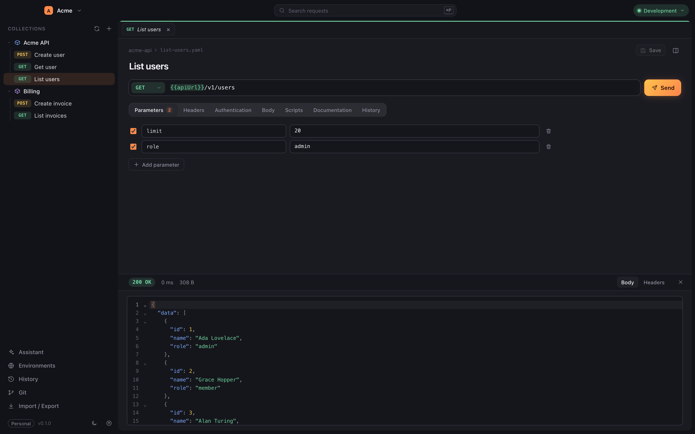

# Awake

[](https://github.com/awake-client/awake/actions/workflows/continuous-integration.yml)
[](https://github.com/awake-client/awake/actions/workflows/release.yml)
[](https://github.com/awake-client/awake/releases)
[](LICENSE)

A git-native API client for macOS, Linux and Windows. Collections, requests and
environments are plain YAML files in a git repository, so a team collaborates
through git instead of a cloud account.



## Features

- **Files as the source of truth** — one readable YAML file per request, with
  reviewable diffs and ordinary git history.
- **HTTP, SSE and WebSocket** — parameters, headers, basic, bearer, API key and
  OAuth 2 authentication, bodies and request scripts.
- **Environments** — shared variables with local overrides; secret values stay
  in the operating system keychain and never in the repository.
- **Coding agents** — chat with Claude Code or OpenCode to rename requests,
  extract base URLs or change anything else in the workspace.
- **Import and export** — Bruno, OpenCollection, OpenAPI and Postman.
- **Built to stay fast** — virtualized tree, SQLite index, search, command
  palette, request history, light and dark themes.

## Install

Download the latest build for your platform from
[Releases](https://github.com/awake-client/awake/releases). Every `v*` tag
publishes macOS (`arm64`, `amd64`), Linux (`amd64`, `arm64`) and Windows
(`amd64`) builds.

## Development

Requires Go 1.26+, Node.js 22+ and the
[Wails v3 CLI](https://v3.wails.io) (`go install github.com/wailsapp/wails/v3/cmd/wails3@latest`).

```sh
wails3 task dev     # run with hot reload
wails3 task test    # Go and Angular test suites
wails3 task build   # build for the host platform
wails3 task package # create the platform package
```

## Documentation

- [File format](docs/file-format.md)
- [Architecture and conventions](docs/conventions.md)

## License

GPL-3.0-or-later. See [LICENSE](LICENSE).
